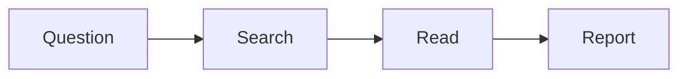

# Week 5, Session 1: Structured Files and Data Analysis

**COSC-300/500 Applied AI Essentials** · Surface: S1 Chat assistant · Capability: C11 Data analysis with code execution · 4D focus: Description

> **Instructor note: preparation.** Prepare a messy demo dataset (a few hundred rows) with a planted problem that produces a wrong aggregate if not caught: duplicate IDs, mixed units (some values in thousands), or a category spelled two ways. Have the provided assignment dataset posted for students who didn't find one. Timing: 15 min structured files, 25 min data analysis demo, 35 min guided practice.

## What you will be able to do after this session

- Use Markdown, CSV, JSON, and Mermaid as working formats between you and an AI.
- Have an AI analyze a dataset by running code, and check the analysis as well as the chart.

## 1. Structured files

Some file formats are easy for both people and AI to read, write, and check. Asking for output in one of these formats, instead of "make it look nice", gives you something you can edit, verify, and move between tools.

| Format | What it's for | Example |
|---|---|---|
| **Markdown** | Documents, notes, instructions | Headings with `#`, bullets with `-`, **bold** with `**` |
| **CSV** | Tables of data | One row per line, values separated by commas |
| **JSON** | Structured records and app data | `{"name": "Ada", "year": 2027}` |
| **Mermaid** | Diagrams written as text | `flowchart LR` followed by boxes and arrows |

These formats matter for three reasons. They're easy to check, because you can read them directly. They move cleanly between tools: a CSV made in one place opens anywhere. And they're the language of the agent work coming in weeks 6 and 7: instruction files and skills are written in Markdown.

### Markdown in a minute

```markdown
# A heading
## A subheading
- a bullet
**bold** and *italic*
| a | table |
|---|---|
| 1 | 2 |
```

### Mermaid in a minute



Ask a model to "draw this process as a Mermaid flowchart" and you get a diagram you can edit as text.

## 2. Data analysis with code execution

Many chat tools can now **write and run code** on data you upload (capability **C11**). You upload a spreadsheet or CSV and ask a question; the model writes a short program, runs it, and reports the result, often with a chart. This is far more reliable than asking a model to do arithmetic in its head, because the computer does the calculation.

But "the code ran" doesn't mean "the analysis is right." The model chose how to clean the data, which rows to drop, how to group categories, and which calculation to run. Any of those choices can be wrong, and the chart will look just as convincing.

The code is visible. **Read it**, or at least ask the model to explain each step in plain language.

> **Instructor note: demo.** Upload your messy dataset. First, ask for a cleaning plan before any analysis, and show students how to approve or change it. Then run the analysis and produce a chart. Then open the code and find the wrong aggregation together. Ask the class: would you have caught this from the chart alone?

### Check the analysis, not just the chart

- Compare **row counts** before and after cleaning. What was dropped, and why?
- Check **units and categories**. Are "NY" and "New York" being counted separately?
- **Recompute three numbers yourself**, in a spreadsheet or by hand.
- Make sure the chart matches the underlying table.

## 3. Guided practice

Using your dataset (or the provided one):

1. Upload it and ask for a cleaning plan. Approve it or change it.
2. Run two analyses that answer questions you care about.
3. Start your **verification log**: which numbers you recomputed, and anything you found wrong.

This is the first half of this week's assignment.

> **Instructor note.** Some students will have no instinct for what questions to ask of data. Suggest: what's the trend over time, how do groups compare, what's unusual. Encourage everyone to recompute at least one number before leaving.

## 4. Responsible use: what may you upload?

Before uploading data, think about whose data it is. Student records are protected by **FERPA**. Data from an employer or client is usually confidential. Personal information about other people deserves the same care. A useful test: if you wouldn't email it to a stranger, don't upload it to a consumer AI tool.

## Coming up Thursday

Producing reports, slide decks, and diagrams; using images and PDFs as input; AI inside Outlook; and generative media.

## Key terms

**Markdown, CSV, JSON, Mermaid**: structured text formats. **Code execution**: the model writes and runs a program to answer a question. **Verification log**: a record of what you checked and what you found.

> **Instructor note: book links.** Structured Files for AI Workflows.
