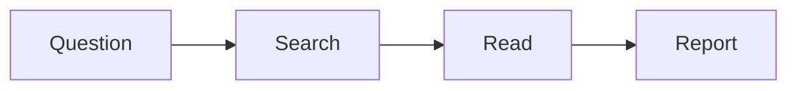

# Week 5: Structured files

**COSC-300/500 Applied AI Essentials** · 4D focus: Description

> **Instructor note: preparation.** Prepare a messy demo dataset (a few hundred rows) with a planted problem that produces a wrong aggregate if not caught: duplicate IDs, mixed units (some values in thousands), or a category spelled two ways. Have the provided assignment dataset posted for students who didn't find one. Timing: 15 min structured files, 25 min data analysis demo, 35 min guided practice.

## What you will be able to do

- Read and write basic Markdown, CSV, JSON, and Mermaid.
- Choose the right format for a piece of output and ask for it by name.
- Explain why plain-text formats are easier to check than finished-looking files.
- Recognize common problems in each format.

## Why format is part of the description

This week's 4D skill is Description again. In Week 2 you described the task. This week you describe the **shape of the output**.

"Make it look nice" leaves the model to choose a form, and you get something that is hard to reuse. Naming a format gives you something you can edit, verify, and move between tools. Four formats come up constantly in AI work. All four are **plain text**: you can open them in any text editor and read them directly, with nothing hidden.

| Format | What it's for | File extension |
|---|---|---|
| **Markdown** | Documents, notes, instructions | `.md` |
| **CSV** | Tables of data | `.csv` |
| **JSON** | Structured records and app data | `.json` |
| **Mermaid** | Diagrams written as text | `.mmd`, or inside a Markdown file |

These formats matter for three reasons:

- **They're easy to check.** What you see is everything there is. A Word file or a spreadsheet can hide formulas, formatting, and tracked changes. A text file can't.
- **They move cleanly between tools.** A CSV made in one place opens in Excel, Google Sheets, and every data tool. Markdown pastes into a chat, a notes app, or a website.
- **They're what agents work in.** In Weeks 6 and 7, the instruction files and skills you write for an agent are Markdown files. In Week 11, programs exchange data with models as JSON.

## Markdown

Markdown is a way to mark up a document's structure with ordinary characters. You have been reading it all term: chat tools write their replies in Markdown and display the result, which is where the headings, bullets, and bold text in a reply come from. This course's lessons and slides are Markdown files.

```markdown
# A heading
## A subheading

A paragraph with **bold** and *italic* text, and a [link](https://example.com).

- a bullet
- another bullet

1. a numbered step
2. the next step

| Name | Year |
|---|---|
| Ada | 2027 |
```

The symbols to know:

| You type | You get |
|---|---|
| `# ` at the start of a line | A heading. More `#` signs make smaller headings. |
| `- ` at the start of a line | A bullet |
| `1. ` at the start of a line | A numbered item |
| `**text**` | Bold |
| `*text*` | Italic |
| `[words](address)` | A link |
| Lines of cells separated by pipes | A table |

Markdown matters for prompts too. Headings and bullets in a long prompt help a model see its parts, in the way tags did in Week 2.

## CSV

CSV stands for comma-separated values. It is the simplest format for a table: one row per line, with commas between the values. The first line usually holds the column names.

```
student_id,major,credits,gpa
1041,Nursing,62,3.4
1042,"Business, Marketing",45,3.1
1043,Cybersecurity,,3.8
```

Three things to notice. The second row puts its major in quotation marks because the value contains a comma. The third row has an empty value for credits, shown by two commas with nothing between them. And every value is just text: nothing in the file says that `gpa` is a number or that `1041` is an ID you shouldn't add up.

Common problems with CSV files, which matter in the next topic:

- A comma inside a value that isn't quoted, which shifts the rest of the row one column over.
- The same thing written several ways: "NY", "New York", "new york".
- Dates in mixed formats: `3/4/2026` is March 4 in the United States and April 3 in much of the world.
- Numbers stored with symbols, such as `$1,200` or `45%`.
- Blank cells, which might mean zero, unknown, or not applicable.

When you want data from a model, asking for CSV gives you something you can open in a spreadsheet and check.

## JSON

JSON is a format for structured records. It is built from two things: **objects**, which are sets of named values inside curly braces, and **lists**, which are ordered values inside square brackets.

```json
{
  "name": "Ada Okafor",
  "year": 2027,
  "enrolled": true,
  "majors": ["Data Science", "Mathematics"],
  "advisor": { "name": "Dr. Lee", "office": "Reid 210" }
}
```

A CSV can only hold a flat table. JSON can nest: this student has a list of majors, and an advisor who has their own name and office. That makes JSON the usual format for data passed between programs.

You'll meet JSON in two ways. Settings files for the tools in the second half of the course are often JSON. And when you want a model's output to go into a program or a spreadsheet, asking for JSON with named fields gives you a predictable structure:

> Read the job posting below and return JSON with these fields: `title`, `company`, `location`, `salary_min`, `salary_max`, and `required_skills` (a list). Use `null` for anything the posting doesn't state.

JSON is strict. A missing comma or an unclosed brace makes the whole file invalid. Models produce valid JSON reliably now, but if a program rejects a file, a stray comma is the first thing to look for. You can paste JSON back into a chat and ask whether it is valid.

## Mermaid

Mermaid is a way to write a diagram as text. A few lines describe boxes and arrows, and a tool draws the picture.



`flowchart LR` means a flowchart that runs left to right. Each letter names a box, the text in square brackets is its label, and `-->` is an arrow. Mermaid can also draw timelines, organization charts, and sequence diagrams.

Ask a model to "draw this process as a Mermaid flowchart" and you get a diagram you can edit. To move a step or rename a box, you change a line of text or ask the model to. Claude and several other tools display Mermaid as a picture in the chat. A diagram generated as an image can't be corrected that way.

## Choosing a format

| You want | Ask for |
|---|---|
| A document, notes, or a set of instructions | Markdown |
| A table you will sort, filter, or chart | CSV |
| Records with nested parts, or output for a program | JSON |
| A flowchart, timeline, or other diagram | Mermaid |
| A finished file to hand to someone | Word, PDF, or slides, built from one of the above (covered later this week) |

A good habit is to work in a plain format while you are still checking and revising, and to convert to a finished file at the end. Errors are easier to see in a plain table than in a formatted report.

## Key terms

**Plain text**: a file that contains only readable characters, with no hidden formatting. **Markdown**: a plain-text format for documents, using symbols such as `#` and `-` for structure. **CSV**: comma-separated values, a plain-text format for tables. **JSON**: a plain-text format for structured, nested records. **Mermaid**: a plain-text format for diagrams.

> **Instructor note: book links.** Structured Files for AI Workflows.
